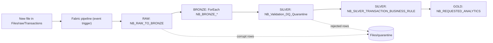

# Noya Pay Bank Data Pipeline: Medallion Architecture on Microsoft Fabric

From messy bank files to trusted, dashboard-ready analytics. A PySpark and Delta Lake pipeline in Microsoft Fabric that ingests raw files, cleans and validates them, applies business rules (FX, fraud and AML), and publishes gold tables and a star-schema fact table for reporting.

  

<!-- TODO: add the LinkedIn carousel link, a pipeline screenshot and a dashboard screenshot, e.g.
 -->

---

## Table of contents

1. [The scenario](#the-scenario)
2. [What this project demonstrates](#what-this-project-demonstrates)
3. [Architecture](#architecture)
4. [Repository structure](#repository-structure)
5. [Data sources](#data-sources)
6. [Layer by layer](#layer-by-layer)
7. [Data quality and validation](#data-quality-and-validation)
8. [Handling real-world data problems](#handling-real-world-data-problems)
9. [Business rules](#business-rules)
10. [Gold layer and star schema](#gold-layer-and-star-schema)
11. [Orchestration in Fabric](#orchestration-in-fabric)
12. [Audit and monitoring](#audit-and-monitoring)
13. [Known issues and roadmap](#known-issues-and-roadmap)

<br>

## The scenario

My manager sent me a set of data requests for new bank data. Before any of them could be answered, the data had to be cleaned and made trustworthy. Each request became a gold table:

| Requester | Request | Gold table |
|---|---|---|
| Relationship managers | One row per customer: spend, income, number of transactions, average ticket, first and last activity, number of alerts | `gold_customer_aggregate` |
| Finance | One row per customer, one column per month of spend | `gold_customer_monthly_spend` |
| Marketing | RFM customer segmentation (recency, frequency, monetary) | `gold_customer_rfm_segmentation` |
| Partnerships | Top 5 merchants per city | `gold_top_5_merchants_of_city` |
| CFO | Spend by channel and category, with subtotal per channel and a grand total | `gold_channel_category_spending_summary` |
| Fraud and AML | Flag suspicious transactions and give each a risk score | `gold_transaction_*_flags`, `gold_transaction_risk_score` |

The product team also asked for extra customer attributes (full name, age, income band, PAN holder type, email domain), and a favourite spending category per customer (`gold_top_n_category_customer`).

<br>

## What this project demonstrates

- **Cleaning:** trimming, casing, category mapping, boolean, date, amount, phone and interest-rate parsing.
- **Late and duplicate data:** latest record per business key, and merges that only update when the incoming record is newer.
- **Schema drift:** renamed columns mapped to one standard, new columns allowed to flow through.
- **Corrupt data:** bad rows split out at ingestion into a quarantine folder, never silently dropped.
- **Data quality and validation:** ERROR and WARN rules, rejected rows quarantined, failures counted per rule and per batch.
- **Medallion architecture:** raw, bronze, silver and gold layers.
- **Privacy:** credit card numbers validated (Luhn), then reduced to the last 4 digits.
- **Flattening nested values:** nested JSON turned into plain columns.
- **Star schema:** a fact table for dashboard reporting.
- **Orchestration:** a Fabric pipeline with an event trigger, a ForEach loop and per-run batch IDs.

<br>

## Architecture



| Layer | What happens | Notebooks | Tables |
|---|---|---|---|
| **Raw** | Source files ingested as they are, with ingestion metadata. Corrupt rows quarantined | `NB_RAW_TO_BRONZE` | `bronze.bronze_*` |
| **Bronze** | Cleaned, typed, standardised, deduplicated, nested values flattened | `NB_BRONZE_*` | `validate.bronze_clean_*` (merchants and FX rates go straight to `silver.*`) |
| **Silver** | Validated against DQ rules, enriched with more attributes and joined across tables | `NB_Validation_DQ_Quarantine`, `NB_SILVER_TRANSACTION_BUSINESS_RULE` | `silver.silver_*` |
| **Gold** | Business-ready tables, risk flags and the star-schema fact table | `NB_SILVER_TRANSACTION_BUSINESS_RULE`, `NB_REQUESTED_ANALYTICS` | `gold.*` |

> **Naming note:** the raw layer writes to a schema called `bronze`, and the cleaned bronze layer writes to a staging schema called `validate`. The layer names above describe what each step does, not the schema names.

<br>

## Repository structure

```
.
├── notebooks/
|   ├── Functions/
│   |   ├── NB_FUNCTIONS.ipynb                      # shared helper functions
|   ├── Raw/
│   |    ├── NB_RAW_TO_BRONZE.ipynb                  # raw ingestion + metadata + quarantine
|   ├── Bronze/
│   |    ├── NB_BRONZE_CUSTOMERS.ipynb
│   |    ├── NB_BRONZE_ACCOUNTS.ipynb
│   |    ├── NB_BRONZE_TRANSACTIONS.ipynb
│   |    ├── NB_BRONZE_MERCHANTS.ipynb
│   |    ├── NB_BRONZE_FX_RATES.ipynb
|   ├── Validate/
│   |    ├── NB_Validation_DQ_Quarantine.ipynb       # DQ rules + routing to silver / quarantine
|   ├── Silver/
│   |    ├── NB_SILVER_TRANSACTION_BUSINESS_RULE.ipynb  # FX, balances, fraud and AML
│   |    └── NB_REQUESTED_ANALYTICS.ipynb            # gold tables per business request
├── data/
├── docs/                                       # carousel, screenshots
└── README.md
```

Lakehouse file directory:

```
Files/
├── raw/
│   ├── customers.csv
│   ├── accounts.csv
│   ├── merchants.json
│   ├── fx_rates.csv
│   ├── mcc_codes.csv
│   └── Transactions/transaction_*.json/
└── quarantine/        # corrupt rows, schema drift and DQ rejections
```

Lakehouse schemas: `bronze`, `validate`, `silver`, `gold`, `etl_audit_log`, `dq_monitoring`.

<br>

## Data sources

<!-- TODO: state whether the data is synthetic. No real customer data should be committed to this repo. -->

| Source | Format | Notes |
|---|---|---|
| `customers.csv` | CSV, comma-delimited | Names, DOB, PAN, contact details, KYC status, income |
| `accounts.csv` | CSV, pipe-delimited | Savings, current, credit card and fixed deposit accounts, including card numbers |
| `Transactions/<file>` | JSON | Nested fields (merchant, tags), possible schema drift |
| `merchants.json` | Multi-line JSON | Nested `category` and `address` structs |
| `fx_rates.csv` | CSV | Daily rates by currency |
| `mcc_codes.csv` | CSV | Merchant category codes with a high-risk flag |

<br>

## Layer by layer

### Raw: `NB_RAW_TO_BRONZE`

- Reads each source with an explicit schema (mostly strings, so nothing is lost to type errors) in `PERMISSIVE` mode with a `_corrupted_record` column.
- Adds ingestion metadata: `_source_file`, `_source`, `_loaded_at`, `_batch_id`.
- Splits clean and corrupt rows. Corrupt rows are written as JSON to `Files/quarantine/corrupt_<entity>/`.
- Clean rows go to `bronze.bronze_<entity>`. Reference and dimension-like sources are overwritten. Transactions are **appended**.
- Writes one row per entity to the audit table.

### Bronze: `NB_BRONZE_*`

| Notebook | What it does | Writes |
|---|---|---|
| **Customers** | Removes null tokens. Trims and fixes casing (names, email lower, PAN upper, IDs upper). Maps gender to M/F/O/U, country to IN, booleans to True/False. Parses four date formats, income and phone (strips +91 or 0, keeps 10 digits starting 6 to 9). Keeps the latest row per `customer_id`. Adds `full_name`, `age`, `tenure`, `email_domain`, `pan_holder_type`, `income_band` | `validate.bronze_clean_customers` (overwrite) |
| **Accounts** | Maps account types (SB, CA, CC, FD) and currency symbols. Parses dates, credit limit and interest rate. Validates card numbers with the **Luhn** checksum, keeps only `card_last4`, drops the full number. Keeps the latest row per `account_id` | `validate.bronze_clean_accounts` (overwrite) |
| **Transactions** | Maps renamed columns (schema drift). Maps debit/credit/refund codes, currencies and channels. Parses amounts and timestamps (epoch millis, ISO, naive values assumed IST) and derives `txn_date_ist`. **Flattens** nested columns. Derives `is_international`, `tag_count`, `tags_text`. Cleans merchant names and validates 4-digit MCCs. Drops exact duplicates, keeps the latest row per `txn_id`. Partitions by `txn_month` | `validate.bronze_clean_transactions` (append, partitioned) |
| **Merchants** | Extracts `mcc` (zero-padded), `city`, `country` from nested structs. Removes `(old)` duplicates | `silver.silver_merchants` (overwrite) |
| **FX rates** | Casts `rate_date` to date and `rate` to `decimal(18,6)`, nulls non-positive rates | `silver.silver_fx_rates` (overwrite) |

Income bands: under 5 lakh is `MASS`, under 15 lakh `AFFLUENT`, under 50 lakh `HNI`, otherwise `ULTRA_HNI`. PAN holder type comes from the 4th character (`P` individual, `C` company).

### Silver: validation and enrichment

`NB_Validation_DQ_Quarantine` applies the rules below and routes the data. `NB_SILVER_TRANSACTION_BUSINESS_RULE` enriches the validated transactions and writes `silver.silver_transaction_enriched` plus the fraud and balance tables.

### Gold

Tables built for each request, plus the transaction fact table. See [Gold layer and star schema](#gold-layer-and-star-schema).

<br>

## Data quality and validation

Rules are SQL expressions with a severity. A row with any **ERROR** is rejected to `Files/quarantine/DQ_Rejection/<entity>` as Parquet. **WARN** rows continue to silver and are counted in the monitoring table.

**Customers**

| Rule | Severity |
|---|---|
| `customer_id_format` (`CUST` + 5 digits), `dob_valid`, `age_18_plus` | ERROR |
| `email_format`, `phone_valid`, `pan_format`, `pincode_format`, `kyc_status_allowed`, `income_valid` | WARN |

**Accounts**

| Rule | Severity |
|---|---|
| `account_type_known`, `open_date_valid`, `closed_after_open`, `card_luhn_valid`, `customer_not_exists` (orphan account) | ERROR |
| `closed_has_date`, `ifsc_format`, `limit_only_for_cards`, `currency_inr` | WARN |

**Transactions**

| Rule | Severity |
|---|---|
| `account_id_present`, `account_exists`, `txn_ts_valid`, `txn_not_in_future`, `amount_parsed`, `amount_positive`, `currency_known`, `txn_type_known`, `status_known`, `not_after_account_closed` | ERROR |
| `refund_original_missing`, `refund_account_mismatch`, `refund_exceeds_original` | ERROR |
| `channel_known`, `not_before_account_open`, `mcc_valid` | WARN |

<br>

## Handling real-world data problems

| Problem | How it is handled |
|---|---|
| Messy values | Null-token removal, trimming, casing, category dictionaries, multi-format date and amount parsing |
| Late and duplicate updates | `latest_by_key` keeps the newest row per business key by `updated_at`. Silver merges only update when `source.updated_at > target.updated_at`, so an older record never overwrites a newer one |
| Schema drift | The raw notebook compares incoming columns with the expected schema and flags drifted batches to a schema-drift quarantine folder. A column mapping renames legacy names (`txn_amount`, `transaction_timestamp`, `transaction_id`, `transaction_type`). Silver merges run with Delta schema auto-merge, so new columns flow through |
| Corrupt records | `PERMISSIVE` reads with a corrupt-record column. Bad rows are quarantined at ingestion with entity, batch, source file and timestamp |
| Failed validation | ERROR rows go to quarantine, never silently dropped. Failure counts per rule are logged for every batch |
| Sensitive data | Card numbers are Luhn-checked, then only the last 4 digits are kept. The full number never moves past the raw layer |
| Nested JSON | Flattened into `parent_child` columns (for example `merchant_location_city`) |

<br>

## Business rules

**FX and amounts**
- A daily rate calendar runs from the first rate date to `AS_OF`. Gaps are filled with the last known rate per currency, INR is 1.
- `amount_inr = amount x rate`, `amount_usd = amount_inr / usd_inr`.

**Cash flow and balances**
- Debit is outflow, credit and refund are inflow. Failed or pending transactions count as 0.
- Running net position per account, and the closing position per account per day.

**Categories**
- Category comes from the MCC reference. Fallbacks: ATM is Cash Withdrawal, UPI/NEFT/IMPS is Transfers, otherwise Uncategorised.

**Fraud and AML flags**

| Flag | Rule | Weight |
|---|---|---|
| `flag_velocity` | 5 or more card transactions within 10 minutes | 40 |
| `flag_structuring` | 3 or more debits of ₹45,000 to under ₹50,000 via IMPS/NEFT/UPI within 24 hours | 50 |
| `flag_high_value` | Amount of ₹2,00,000 or more | 20 |
| `flag_high_risk_mcc` | Debit at a high-risk merchant category | 25 |
| `flag_dormant_activity` | Successful debit on a dormant account | 35 |
| `flag_odd_hour` | Between midnight and 5 am IST | 5 |
| `flag_round_amount` | Multiple of ₹10,000 (at least ₹10,000) | 5 |

Risk score is the sum of the weights. Band: **HIGH** at 50 or more, **MEDIUM** at 25 or more, otherwise **LOW**. Weights were set by the requester.

## Gold layer and star schema

**Fact table:** `gold_fact_transaction` (one row per transaction) with `txn_id`, `account_id`, `customer_id`, `txn_ts`, `txn_date_ist`, `txn_type`, `channel`, `status`, `currency`, `amount`, `amount_inr`, `amount_usd`, `signed_amount_inr`, `category`, `merchant_name`, `merchant_location_city`, `is_international`, `risk_score`, `risk_band`.

<!-- TODO: confirm the dimension table names and join keys, then update this line. -->
**Dimensions:** customers (`silver.silver_customers`), accounts (`silver.silver_accounts`), merchants (`silver.silver_merchants`), and a date dimension keyed on `txn_date_ist`.

**Other gold tables**

| Table | Purpose |
|---|---|
| `gold_account_running_position` | Per-transaction running net position |
| `gold_account_daily_position` | Closing net position per account per day |
| `gold_transaction_velocity_flags`, `gold_transaction_structuring_flags`, `gold_transaction_risk_flags`, `gold_dormant_activity_flags` | One table per fraud and AML rule |
| `gold_transaction_risk_score` | Weighted score and band per transaction |
| `gold_customer_aggregate` | One row per customer for relationship managers |
| `gold_top_n_category_customer` | Favourite spending category per customer |
| `gold_customer_monthly_spend` | One column per month for Finance |
| `gold_customer_rfm_segmentation` | R, F and M scores from quintiles |
| `gold_top_5_merchants_of_city` | Top 5 merchants by spend in each city |
| `gold_channel_category_spending_summary` | Spend in crore by channel and category with subtotals |

All gold writes use Delta `MERGE` on a natural key, so reruns update rather than duplicate.

<br>

## Orchestration in Fabric


| Step | Notebook | Layer |
|---|---|---|
| 1 | `NB_RAW_TO_BRONZE` | Raw |
| 2 | `NB_BRONZE_*` (one per source, run by a **ForEach**) | Bronze |
| 3 | `NB_Validation_DQ_Quarantine` | Silver |
| 4 | `NB_SILVER_TRANSACTION_BUSINESS_RULE` | Silver and gold |
| 5 | `NB_REQUESTED_ANALYTICS` | Gold |

- **Event trigger:** a new file landing in the `Transactions` folder starts the pipeline automatically.
- **ForEach:** loops over the list of sources and runs one bronze notebook for each.
- **System variables and pipeline variables:** run details plus values such as the batch ID and file name are passed into the notebooks.
- **Notebook parameters** (each notebook has a cell tagged `parameters`):

| Parameter | Used in |
|---|---|
| `BATCH_ID` | Raw, bronze transactions, validation, business rules |
| `TRANSACTION_SOURCE_FILE` | Raw |
| `AS_OF` | Bronze customers, business rules |

<!-- TODO: confirm the exact trigger type and activities against your real pipeline. -->

<br>

## Audit and monitoring

- **`etl_audit_log.etl_audit_logs`:** one row per ingested entity per run with `timestamp`, `logger_name`, `batch_id`, `layer`, `dataframe_name`, `status`, `clean_records_count`, `corrupt_records_count`, `clean_output_path`, `corrupt_output_path`. Status is `SUCCESS` or `WARNING: Corrupt Records Found`.
- **`dq_monitoring.dq_monitoring_table`:** failed-row counts per rule, per entity, per batch. Built to feed a DQ dashboard.
- **Lineage columns:** every raw row carries `_source_file`, `_source`, `_loaded_at` and `_batch_id`.

<br>

## Known issues and roadmap

Honest list of things I would fix next:

- **Signed amount:** `signed_amount_inr` uses `.otherwise("amount_inr")` as a string literal, so credits are not counted correctly in running balances. It needs `F.col("amount_inr")`.
- **Customer tenure:** it is computed from date of birth. It should use `customer_since`.
- **Hard-coded dates:** the "not in future" DQ rules and the RFM `AS_OF` use `2025-07-01` instead of the pipeline parameter.
- **`delta_merge`:** it accepts a match condition but does not use it.
- **Rollup merge keys:** the channel and category summary merges on columns that are NULL for subtotal rows, so those rows can duplicate on rerun. Use a null-safe comparison.
- **Ranked tables:** merges only upsert, so a merchant that falls out of a city's top 5 stays in the table.
- **Schema-drift handling:** a drifted batch is logged but still loaded. It should stop or quarantine properly.
- **Idempotency:** re-running the same transactions file appends duplicates to the raw table.
- **Small fixes:** wrong source name written for FX rates lineage, customer quarantine folder name mismatch in the audit log, and the orphan transaction check currently finds accounts without transactions.
- **Next:** unit tests for the helper functions, Great Expectations style checks.

## Author

**Evan Saju Mathew**: Data Engineer · [GitHub](https://github.com/evanmathew)
